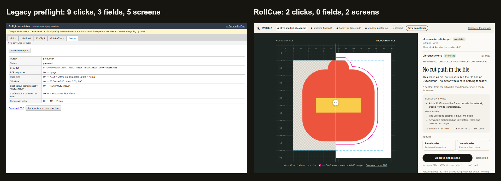

# Legacy comparison

## What is compared

The "old way" is `/legacy`: a **representative** multi-tab preflight workstation, built for this comparison. It is not a copy of any real product. It follows the shape most prepress tools share: a job list, a ticket form where the operator states the product type, a preflight report, a cut-and-offsets tab and an output tab. It runs on **the same backend, the same jobs and the same checks** as RollCue. Only the surface differs. Its decisions are sent as manual entries, so they never feed RollCue's correction memory.

The comparison is generous to the legacy surface. Its preflight is RollCue's preflight, so it is exactly as accurate. The only thing it lacks is that nothing happens until the operator asks.

## Method

`e2e/compare.spec.ts` drives both surfaces with Playwright in fresh sessions. For each job it takes the path the legacy surface enforces: it will not generate output until the ticket is saved, preflight has been run and a cut method has been applied. (Codex review R1 showed that an earlier version let the operator open the Output tab and approve RollCue's prepared file directly, skipping every manual step. That shortcut is now blocked, and `e2e/rollcue.spec.ts` tests that it stays blocked.) Every operator action goes through one counting helper, so the numbers are what the script actually did:

- **clicks:** buttons, tabs, links;
- **fields:** form inputs the operator must fill or choose (product type, cut method, offset);
- **screens:** distinct views the operator has to visit;
- **decisions:** what the operator had to know or judge.

Results are written to [`evidence/comparison.json`](evidence/comparison.json) on every run.

## Results

| Job | Surface | Clicks | Fields | Screens | What the operator had to decide |
|---|---|---|---|---|---|
| Clean sticker job (`olive-market-sticker.pdf`) | Legacy | 9 | 3 | 5 | product type; read the preflight table; cut method; offset 2 mm; approve |
| | **RollCue** | **2** | **0** | **2** | approve the prepared file |
| Wrong-guess job (`stickers-final.pdf`) | Legacy | 9 | 2 | 5 | product type; read the preflight table; cut method (none); approve |
| | **RollCue** | **4** | **0** | **2** | correct the intent to Poster; approve |

## Reading the results fairly

- **Clicks are not the main difference.** The legacy operator must already know what the job is, which cut method suits it, and what offset to type. RollCue had worked all of that out, prepared the file and verified it before the operator opened the job. In RollCue the operator's role is to judge a finished result, not to produce one.
- **The wrong-guess job is closer.** When RollCue's reading is wrong, the operator still has to notice and correct it. RollCue makes that likely by flagging thin evidence, and cheap with one correction. But a legacy operator who already knows "poster" needs only two fields (product type and cut method). RollCue's advantage there is the next similar file, which it gets right without asking.
- **Time is not reported as a result.** The script waits 1.9 s on the RollCue side for the cut-line animation to finish before taking the screenshot. Both surfaces also wait on the same server work. Wall-clock numbers in the JSON are recorded but are not a fair comparison.
- **The legacy surface was built by the same team as RollCue,** so its friction is a model of common practice, not a measurement of any vendor's product. Its step order has not been validated by a practising print operator.
